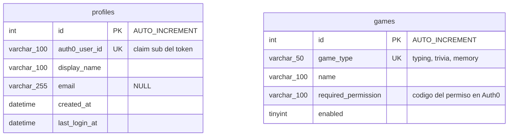

# battlehub-profile-service

Servicio **Identity & Profile** del proyecto BattleHub, a cargo del **Equipo 1**.

El Shell inicia sesión con Auth0 y envía el token del usuario a este servicio, que guarda su perfil local y responde qué juegos y permisos tiene habilitados. El Equipo 1 también crea y administra el tenant de Auth0 del proyecto.

En la Etapa 2, los permisos pasan a leerse de Auth0 mediante una aplicación M2M del Profile Service, con un endpoint unificado `GET /api/profiles/me/access` (R-47, R-48).

## Stack

| Componente | Tecnología |
|---|---|
| Backend | .NET 10, ASP.NET Core Web API (solución `.slnx`, Visual Studio 2026) |
| Base de datos | MySQL 8.4 con EF Core 10 |
| Identidad | Auth0 (JWT) |
| Contenedores | Docker y Docker Compose |
| CI | GitHub Actions |

## API

Base URL: `/api/profiles`. Todos los endpoints exigen `Authorization: Bearer <token>` con el access token del usuario.

| Método | Ruta | Descripción |
|---|---|---|
| POST | `/api/profiles/sync` | Crea el perfil local si no existe o lo actualiza. Responde `201` la primera vez y `200` después. Rechaza con `403` los tokens de máquina (M2M). |
| GET | `/api/profiles/me` | Perfil del usuario del token. `404` si todavía no hizo `sync`. |
| GET | `/api/profiles/me/permissions` | Códigos de permiso del usuario (consultados desde Auth0). |
| GET | `/api/profiles/me/games` | Juegos habilitados para el usuario (cruzando catálogo con permisos de Auth0). |
| GET | `/api/profiles/me/access` | Respuesta unificada de acceso: JSON con `userId`, `permissions` y `games` habilitados para el usuario a partir de Auth0 Management API (R-47, R-48). |
| GET | `/health` | Estado del servicio. No requiere token. |

- Las fechas van siempre en UTC, en formato ISO-8601 con sufijo `Z` (por ejemplo `2026-09-02T20:00:00Z`).
- Los errores siguen el formato ProblemDetails (`application/problem+json`).
- El identificador del perfil es el `sub` del token de Auth0; nunca se toma de lo que envía el cliente.

## Ejecución local (Docker Compose)

Requisito: [Docker Desktop](https://www.docker.com/products/docker-desktop/), o Docker Engine con Docker Compose.

1. Crear el archivo de variables a partir del ejemplo y completar los valores (contraseñas de MySQL, dominio y audience de Auth0):

   ```bash
   cp .env.example .env
   ```

2. Levantar todo:

   ```bash
   docker compose up --build
   ```

   Los servicios arrancan en este orden:

   | Servicio | Qué hace |
   |---|---|
   | `mysql` | MySQL 8.4, con los datos en el volumen `profile-mysql-data`. |
   | `migrate` | Aplica las migraciones, que incluyen el catálogo de juegos (seed), y termina. |
   | `generar-datos` | Ejecuta `docker/datos/generar-datos.sql`, que inserta perfiles de ejemplo, y termina. |
   | `api` | La API, en `http://localhost:5220`. Arranca solo cuando lo anterior terminó bien. |

3. Comprobar que funciona:

   ```bash
   curl http://localhost:5220/health
   ```

   Responde `Healthy`.

4. Detener y borrar todo, incluidos los datos:

   ```bash
   docker compose down -v
   ```

No hay scripts de arranque: el único comando para levantar el servicio es `docker compose up`.

### Si ya habías levantado el compose antes

El modelo de datos cambió: las claves primarias pasaron a enteras y desaparecieron las tablas de permisos. **Un volumen creado con el esquema anterior hace fallar el servicio `migrate`**, porque intenta crear la tabla `profiles` y esa tabla ya existe con la forma vieja. En los logs se ve así:

```
migrate-1  | ... Table 'profiles' already exists
```

No es un error del código: es el volumen. Se resuelve borrándolo antes de volver a levantar:

```bash
docker compose down -v
docker compose up --build
```

Se puede borrar sin reparos: en ese volumen solo hay el catálogo de juegos y los perfiles de ejemplo que genera `docker/datos/generar-datos.sql`, y los dos se vuelven a crear en cada arranque.

## Ejemplos de llamadas con curl

Las llamadas a `/api/profiles` necesitan el access token de un usuario. Para obtenerlo, inicie sesión en el Shell con uno de los usuarios de demostración, abra las herramientas de desarrollador del navegador (pestaña **Network**) y copie el valor del encabezado `Authorization` de cualquier llamada a `/api/profiles`, sin la palabra `Bearer`.

```bash
TOKEN="<access token del usuario>"
```

Sincronizar el perfil (crearlo o actualizarlo):

```bash
curl -X POST http://localhost:5220/api/profiles/sync \
  -H "Authorization: Bearer $TOKEN" \
  -H "Content-Type: application/json" \
  -d '{"displayName": "Ana"}'
```

Consultar el perfil, los permisos, los juegos y el acceso unificado:

```bash
curl http://localhost:5220/api/profiles/me -H "Authorization: Bearer $TOKEN"
curl http://localhost:5220/api/profiles/me/permissions -H "Authorization: Bearer $TOKEN"
curl http://localhost:5220/api/profiles/me/games -H "Authorization: Bearer $TOKEN"
curl http://localhost:5220/api/profiles/me/access -H "Authorization: Bearer $TOKEN"
```

Sin token, la respuesta es `401`:

```bash
curl -i http://localhost:5220/api/profiles/me
```

## Configuración

Toda la configuración llega por variables de entorno. `docker compose` las toma del archivo `.env`, que no se versiona; `.env.example` documenta cada una sin valores reales.

| Variable en `.env` | Se pasa a la API como | Para qué sirve |
|---|---|---|
| `MYSQL_ROOT_PASSWORD` | — | Contraseña de `root` del contenedor de MySQL. |
| `MYSQL_DATABASE` | parte de `ConnectionStrings__DefaultConnection` | Nombre de la base de datos. |
| `MYSQL_USER` | parte de `ConnectionStrings__DefaultConnection` | Usuario con el que se conectan la API, la migración y la generación de datos. |
| `MYSQL_PASSWORD` | parte de `ConnectionStrings__DefaultConnection` | Contraseña de ese usuario. |
| `AUTH0_DOMAIN` | `Auth0__Domain` | Dominio del tenant de Auth0. |
| `AUTH0_AUDIENCE` | `Auth0__Audience` | Identifier de la API en Auth0 con el que se emiten los tokens que acepta el servicio. |
| `AUTH0_MGMT_CLIENT_ID` | `Auth0__Management__ClientId` | Client ID de la aplicación Machine-to-Machine de Profile Service para consultar Auth0 Management API (R-47). |
| `AUTH0_MGMT_CLIENT_SECRET` | `Auth0__Management__ClientSecret` | Client Secret de la aplicación Machine-to-Machine. Se guarda en `.env` (nunca se versiona). |
| `AUTH0_MGMT_AUDIENCE` | `Auth0__Management__Audience` | Audience de Auth0 Management API (`https://<AUTH0_DOMAIN>/api/v2/`). Opcional. |
| `AUTH0_API_TYPING` | `Auth0__PermissionApis__Typing` | Identifier de la API de Typing Battle en Auth0, donde vive `games.typing.play`. **Obligatoria.** |
| `AUTH0_API_TRIVIA` | `Auth0__PermissionApis__Trivia` | Identifier de la API de Trivia Battle, donde vive `games.trivia.play`. **Obligatoria.** |
| `AUTH0_API_MEMORY` | `Auth0__PermissionApis__Memory` | Identifier de la API de Memory Match, donde vive `games.memory.play`. **Obligatoria.** |
| `AUTH0_API_MATCHMAKING` | `Auth0__PermissionApis__Matchmaking` | Identifier de la API de Matchmaking. Opcional: `matches.create` se asigna en la API de Profile (`AUTH0_AUDIENCE`), y esta variable solo hace falta si el Equipo 2 lo moviera a la suya. |
| `CORS_ORIGIN` | `Cors__Origins__0` | Origen del Shell en local. **Obligatoria.** |
| `CORS_ORIGIN_PUBLISHED` | `Cors__Origins__1` | Origen del Shell publicado. Opcional. |
| `HTTPS_REDIRECT` | `Https__Redirect` | Redirección a HTTPS. `false` mientras la API solo escuche HTTP, porque el navegador no acepta redirecciones en la petición previa de CORS. |
| `PROFILE_API_PORT` | — | Puerto local donde se publica la API (por defecto `5220`). |

El compose también define `DatabaseProvider=MySQL`. Si la API se publica detrás de un proxy que maneja el HTTPS, agregue `ASPNETCORE_FORWARDEDHEADERS_ENABLED=true`.

**La API no arranca si falta una variable obligatoria** (R-09): no hay valores por defecto escritos en el código, y el error dice qué variable falta. Es deliberado — un dominio o una audiencia de relleno harían que el servicio rechazara todos los tokens del tenant real, y una API de juego sin configurar dejaría ese juego invisible para todos los usuarios sin dar ningún error.

#### Por qué las credenciales del M2M son la excepción

`AUTH0_MGMT_CLIENT_ID` y `AUTH0_MGMT_CLIENT_SECRET` **no impiden arrancar**, a propósito. El CI levanta el compose con `.env.example`, que no trae secretos, para comprobar que la imagen arranca, que `/health` responde y que un endpoint protegido devuelve 401. Si fueran obligatorias, ese smoke test exigiría secretos en el repositorio o en los secrets de GitHub, que es justo lo que R-05 y R-32 quieren evitar.

Sin ellas el servicio funciona salvo en lo que depende de Auth0: `/me/access`, `/me/permissions` y `/me/games` responden **503**. Para que eso no haya que diagnosticarlo a partir de una petición fallida, **la API escribe una advertencia al arrancar** diciendo que faltan y qué endpoints quedan sin servicio.

Al aplicar las migraciones (`--migrate`) no se exige ninguna configuración de Auth0 ni de CORS: ese modo solo necesita la base de datos y termina sin atender peticiones.

### Dónde vive cada permiso en Auth0

El Profile Service solo acepta un permiso si coincide **la API que lo emite y su código** a la vez. Un permiso con el nombre correcto emitido por otra API se descarta.

| Permiso | API de Auth0 que lo concede |
|---|---|
| `games.typing.play` | `AUTH0_API_TYPING` |
| `games.trivia.play` | `AUTH0_API_TRIVIA` |
| `games.memory.play` | `AUTH0_API_MEMORY` |
| `matches.create` | `AUTH0_AUDIENCE` (la API de Profile), o `AUTH0_API_MATCHMAKING` si se define |

### Puertos

| Servicio | Puerto |
|---|---|
| API | `5220` en la máquina local (puerto `8080` dentro del contenedor) |
| MySQL | `3306`, solo dentro de la red del compose; no se publica en la máquina local |
| Shell (Equipo 3), origen permitido por CORS | `4000` |

## Base de datos

- **Motor:** MySQL 8.4, el motor fijado para el Profile Service en la documentación del proyecto. Es el único motor del servicio. La base en memoria **no es una opción de la API**: solo la usan las pruebas, que registran su propio proveedor al construir la aplicación de prueba (R-12).
- **Migraciones:** se aplican de forma explícita con el servicio `migrate` del compose (la API con la opción `--migrate`), nunca al arrancar la API. Hay una migración por cada paso del modelo (R-14): `CreateProfiles`, `CreateGames` y `SeedGamesCatalog`.
- **Seed:** el catálogo de juegos viaja en la migración `SeedGamesCatalog`, porque es parte del contrato con el Shell y no datos de ejemplo.
- **Generación de datos:** `docker/datos/generar-datos.sql` inserta perfiles de ejemplo. Es un proceso aparte del seed y del código de la API, y se puede ejecutar varias veces sin duplicar datos.

### Modelo

Dos tablas. Los permisos no se almacenan: desde la Etapa 2 viven en Auth0 y se consultan con la aplicación M2M (R-47, R-48).



- **Ninguna clave primaria es de tipo texto** (R-13). La clave natural de cada tabla queda como columna única: `profiles.auth0_user_id` y `games.game_type`.
- **La API nunca expone el `id` interno.** El identificador del usuario en todas las respuestas sigue siendo el `sub` de Auth0, como pidió el Shell.
- `games.required_permission` es el punto donde se cruzan las dos fuentes: el catálogo de MySQL y los permisos que devuelve Auth0.
- No hay relación entre las tablas. El diagrama editable está en `docs/diagramas/DiagramaER.drawio`.

## Decisiones técnicas

| Decisión | Por qué |
|---|---|
| EF Core 10 con el proveedor oficial de Oracle (`MySql.EntityFrameworkCore`) | Pomelo, la alternativa habitual, no tiene versión para EF Core 10. |
| Conversor de fechas a UTC | MySQL no guarda la zona horaria; sin el conversor, las fechas leídas saldrían sin el sufijo `Z`. |
| Migraciones con `--migrate` en un servicio aparte | La API no modifica el esquema al arrancar; aplicar migraciones es un paso controlado. |
| Claves primarias enteras con la clave natural como columna única | Cumple R-13. El `sub` de Auth0 es un texto largo que llegaría a cada índice y a cada clave ajena; como columna única cumple la misma función sin ser la clave primaria, y la API sigue exponiendo el `sub` para no cambiarle el contrato al Shell. |
| Una migración por paso del modelo | Cumple R-14. Las tablas de permisos no se crean para borrarlas después: como no había datos reales, se rehízo el historial y simplemente no existen. |
| La base en memoria solo en las pruebas | Cumple R-12. La API admite únicamente MySQL, así que un despliegue mal configurado no puede arrancar guardando perfiles en memoria y perderlos al reiniciar. |
| Toda la configuración por variables de entorno, sin valores por defecto | Cumple R-09. Un marcador por defecto es peor que un fallo al arrancar: el servicio levantaría y rechazaría todos los tokens, o dejaría un juego invisible, sin decir por qué. |
| Generación de datos con un script SQL independiente | Cumple R-28: tras `docker compose up` hay datos, sin mezclar el seed ni el código de la API. |
| Validación completa del JWT de Auth0 | Se valida emisor, audiencia, firma y vigencia; la identidad sale siempre del `sub` del token. |
| Consulta de permisos vía Auth0 Management API (M2M) y endpoint `/me/access` | Cumple R-47 y R-48: los permisos se gestionan en Auth0 y Profile Service los consulta con su propia credencial M2M con `read:users`. El Shell consume un único endpoint con `userId`, `permissions` y `games`. Si Auth0 falla, responde 503 sin conceder acceso por defecto. |
| `/sync` rechaza tokens M2M | Un cliente de máquina no debe registrarse como jugador. |
| Errores con ProblemDetails | Formato estándar de ASP.NET Core, igual en todos los endpoints. |
| CORS con lista explícita de orígenes | Solo el Shell puede llamar a la API desde el navegador. |
| Pruebas de integración contra MySQL real con Testcontainers | Prueban el motor real y no solo una base simulada. |
| Cobertura mínima de 85% medida con ReportGenerator | La exige el proyecto (R-19); el CI falla si baja. |
| Imagen Docker en dos etapas, con usuario sin privilegios y versiones fijas | Imagen pequeña, sin herramientas de compilación ni ejecución como `root`. |

## Seguridad y secretos

- Ningún secreto se versiona: contraseñas y credenciales van en `.env`, que está en `.gitignore`.
- **Revisión del historial (1 de noviembre de 2026):** el único valor sensible que llegó a versionarse fue `User=root;Password=root`, en `appsettings.json` y como valor por defecto en `Program.cs`. Era una credencial de ejemplo para un MySQL local de desarrollo y se eliminó en el PR #7; desde entonces la cadena de conexión solo llega por variables de entorno. Si alguna base usó esa contraseña, debe cambiarse. No se encontraron credenciales de Auth0 en el historial.
- Los tokens nunca se escriben en logs ni en la base de datos.

## Desarrollo

Requisitos: [.NET 10 SDK](https://dotnet.microsoft.com/download) y Docker (para las pruebas contra MySQL).

### Estructura del repositorio

```text
BattleHub.ProfileService.slnx                     → solución
global.json                                       → versión del SDK de .NET (10)
Directory.Build.props, .editorconfig              → advertencias como error y convenciones de código
/src/BattleHub.ProfileService.Api                 → API REST (ASP.NET Core)
/tests/BattleHub.ProfileService.UnitTests         → pruebas unitarias
/tests/BattleHub.ProfileService.IntegrationTests  → pruebas de integración
/docker/datos                                     → script de generación de datos del compose
/.github/workflows                                → workflows de GitHub Actions
Dockerfile, docker-compose.yml, .env.example      → ejecución con Docker
```

### Pruebas

```bash
dotnet test --filter Category=Unit
dotnet test --filter Category=Integration
```

Las pruebas de integración contra MySQL real levantan un contenedor con [Testcontainers](https://dotnet.testcontainers.org/), así que necesitan Docker. Sin Docker se saltan con un aviso; en el CI se ejecutan siempre.

### Cobertura

El CI exige al menos **85% de cobertura de líneas** del código de la API (sin contar migraciones ni código generado), falla si baja de ese valor y publica el resultado como comentario en cada PR.

Para medirla en local (ReportGenerator está fijado en `dotnet-tools.json`):

```bash
dotnet tool restore
dotnet test --collect:"XPlat Code Coverage" --results-directory coverage/raw
dotnet reportgenerator "-reports:coverage/raw/**/coverage.cobertura.xml" "-targetdir:coverage/report" "-reporttypes:TextSummary" "-assemblyfilters:+BattleHub.ProfileService.Api" "-filefilters:-*/Migrations/*;-*/obj/*"
cat coverage/report/Summary.txt
```

En local la cifra puede ser algo menor que en el CI, porque sin Docker se saltan las pruebas contra MySQL.

### Calidad del código

- **Advertencias como error:** `Directory.Build.props` activa `TreatWarningsAsErrors` en todos los proyectos.
- **Linter:** las convenciones están en `.editorconfig` y el CI las verifica. Para comprobarlas o corregirlas en local:

  ```bash
  dotnet format BattleHub.ProfileService.slnx --verify-no-changes
  dotnet format BattleHub.ProfileService.slnx
  ```

  El primero solo revisa; el segundo corrige los archivos. Las migraciones de EF Core quedan fuera, porque son código generado.

### Workflows de GitHub Actions

| Workflow | Cuándo corre | Qué hace |
|---|---|---|
| **CI** (`ci.yml`) | En cada PR hacia `main` y en cada push a `main` | Restore, build, lint, pruebas unitarias, pruebas de integración, cobertura (mínimo 85%) y `docker build`, con una prueba del compose completo que verifica la migración y la generación de datos. Publica en el PR un comentario con la cobertura. |
| **Build y pruebas unitarias** (`build-unitarias.yml`) | En cada push a cualquier rama | Solo build y pruebas unitarias, para tener una respuesta rápida mientras se trabaja. |

## Convenciones

- **Rama `main` protegida:** sin push directo; todo cambio entra por Pull Request con el CI en verde y al menos 1 aprobación.
- **Commits semánticos:** `<tipo>(<alcance opcional>): <descripción>`. Tipos: `feat`, `fix`, `docs`, `test`, `refactor`, `chore`, `ci`, `perf`. Ejemplo: `feat(profile): agregar endpoint POST /api/profiles/sync`.
- **Pull Requests:** título en formato de commit semántico, los requisitos que atiende (R-xx) y evidencia de pruebas.
- **Base de datos:** cada cambio del modelo va en su propia migración, y una migración que ya está en `main` no se edita.

## Equipo 1

| Integrante | Responsabilidad en la Etapa 2 |
|---|---|
| Emmanuel Jimenez (`999EMMANUEL`) | CI y calidad; Docker, generación de datos y documentación |
| Oscar (`OAiza`) | Tenant de Auth0, aplicación M2M y endpoint de acceso |
| Jhony (`Jhonydarkweb`) | Persistencia: modelo de datos y migraciones |
| Jarinton Mendoza (`JarintonMP`) | Estructura de pruebas e integración con el Shell |
